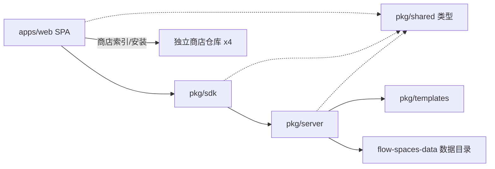

# flow_spaces（monorepo）

Flow Spaces — 工作流可视化编辑器与 Mini App 平台。Vite + React 19 SPA（apps/web）+ Express 5 后端（packages/server）+ 共享类型/SDK/模板包。自 flow-spaces（Next.js）迁移而来（迁移笔记 `MIGRATION-NOTES.md` 已不随本仓分发）。

**2026-11 商店拆仓**：内置 plugins / workflows / mini-apps 内容已从 `packages/templates` 迁出至独立 GitHub 商店仓库，默认经 gh-proxy 按 raw 拉取，路由见 `apps/web/src/lib/agent-store.ts`：

- https://github.com/hunmer/flow-spaces-plugins（插件模板）
- https://github.com/hunmer/flow-spaces-workflows（工作流模板）
- https://github.com/hunmer/flow-spaces-mini-apps（Mini App 商店源）
- https://github.com/hunmer/game-asset-canvas（独立 mini-app 产品示例仓库）

## 快速导航

| 模块 | 职责 | 索引 |
|---|---|---|
| `apps/web` | React 19 SPA（编辑器/Mini App/聊天/BoardUI） | [CLAUDE.md](apps/web/CLAUDE.md) |
| `packages/server` | Express 5 + WS + SQLite + AI 运行时适配 + 运行时数据 | [CLAUDE.md](packages/server/CLAUDE.md) |
| `packages/sdk` | 前端统一 API SDK（17 模块 + 10 demo 页，仅本仓消费） | [CLAUDE.md](packages/sdk/CLAUDE.md) |
| `packages/shared` | 前后端共享 TS 类型（25 域） | [CLAUDE.md](packages/shared/CLAUDE.md) |
| `packages/templates` | Agent Store 内容源（agents/mcps/skills/output-styles/prompt/skillspackage） | [CLAUDE.md](packages/templates/CLAUDE.md) |
| `packages/logs/` | server 运行日志（运行时生成，不入库） | — |

## 根级详情

| 文件 | 用途 | 何时阅读 |
|---|---|---|
| [概述](claude/overview.md) | 架构、模块关系图、设计取舍 | 首次接触 |
| [开发约定](claude/conventions.md) | 命令、i18n 流程、git 边界 | 写代码前 |
| [模块职责](claude/module-responsibilities.md) | 各包职责与规模 | 找模块 |
| [入口与启动](claude/entrypoints.md) | 启动顺序、各模块入口 | 起服务 |
| [对外接口](claude/public-interfaces.md) | 路由/端口/WS/包导出 | 对接 |
| [依赖与配置](claude/dependencies-and-config.md) | 工具链、依赖图、env | 升级 |
| [数据模型](claude/data-model.md) | SQLite+文件混合持久层、商店分发 | 建模 |
| [测试与质量](claude/testing-and-quality.md) | 质量关卡、冒烟路径 | 提交前 |
| [文件索引](claude/file-map.md) | 根目录速查 | 找文件 |
| [FAQ](claude/faq.md) | build:packages/shims/商店路由等常见坑 | 排错 |
| [变更记录](claude/changelog.md) | 更新历史 | 了解变更 |

## 架构速览

- 找功能代码：`docs/feature_map.html`（33 功能节点 / 1626 文件 / 100% 覆盖，2026-11-27 图标精简后重建）或 `rg` / grep（CodeGraph 索引未建，需要时先 `codegraph init`）。
- 商店内容（plugins/workflows/mini-app）默认从独立仓库 GitHub raw 拉取；本地 `/agents-store` 只分发 templates 包内剩余内容（agents/mcps/skills 等）。

## 扫描状态

- **更新时间**: 2026-11-27（init-project 增量更新：商店拆仓 + 编辑器迁移 + 死代码清理）
- **已扫描**: 全仓 tracked 文件清点（git ls-files 1628；死代码清理+图标精简后）、模块结构变化（templates 缩容、logs 移除）、商店路由机制（`agent-store.ts` REPO_ROUTES / `installFromStore` 清单安装）、编辑器迁移（CodeMirror 6 兼容层）、死代码审计与清理（A 档 12 文件 + locales 6 namespace + `AgentSpacesUI`→`FlowSpacesUI` 重命名，已于 2026-11-27 执行完毕，审计报告工作底稿已删）、flow-spaces-data 入库范围（19 文件）
- **未深挖**: 各模块内部细节见各模块 claude/（server services、web components 为清单级）；`packages/sdk/demo/`（10 个演示页，2026-11-27 已逐一核对）
