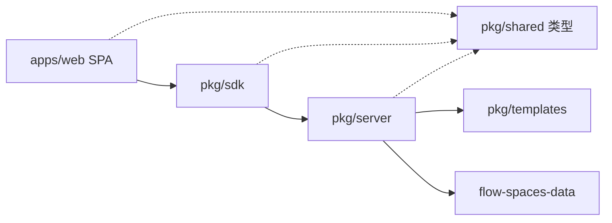

# flow_spaces（monorepo）

Flow Spaces — 工作流可视化编辑器与 Mini App 平台。Vite + React 19 SPA（apps/web）+ Express 5 后端（packages/server）+ 共享类型/SDK/模板包。自 flow-spaces（Next.js）迁移而来，迁移记录见 `MIGRATION-NOTES.md`。

## 快速导航

| 模块 | 职责 | 索引 |
|---|---|---|
| `apps/web` | React 19 SPA（编辑器/Mini App/聊天/BoardUI） | [CLAUDE.md](apps/web/CLAUDE.md) |
| `packages/server` | Express 5 + WS + SQLite + AI 运行时适配 + 运行时数据 | [CLAUDE.md](packages/server/CLAUDE.md) |
| `packages/sdk` | 前端统一 API SDK（24 模块） | [CLAUDE.md](packages/sdk/CLAUDE.md) |
| `packages/shared` | 前后端共享 TS 类型（27 域） | [CLAUDE.md](packages/shared/CLAUDE.md) |
| `packages/templates` | Agent Store 内容（42 插件模板 + 10 Mini App） | [CLAUDE.md](packages/templates/CLAUDE.md) |
| `packages/logs` | 运行日志（不入库） | — |

## 根级详情

| 文件 | 用途 | 何时阅读 |
|---|---|---|
| [概述](claude/overview.md) | 架构、模块关系图、设计取舍 | 首次接触 |
| [开发约定](claude/conventions.md) | 命令、i18n 流程、git 边界 | 写代码前 |
| [模块职责](claude/module-responsibilities.md) | 各包职责与规模 | 找模块 |
| [入口与启动](claude/entrypoints.md) | 启动顺序、各模块入口 | 起服务 |
| [对外接口](claude/public-interfaces.md) | 路由/端口/WS/包导出 | 对接 |
| [依赖与配置](claude/dependencies-and-config.md) | 工具链、依赖图、env | 升级 |
| [数据模型](claude/data-model.md) | SQLite+文件混合持久层 | 建模 |
| [测试与质量](claude/testing-and-quality.md) | 质量关卡、冒烟路径 | 提交前 |
| [文件索引](claude/file-map.md) | 根目录速查 | 找文件 |
| [FAQ](claude/faq.md) | build:packages/shims/mermaid 等常见坑 | 排错 |
| [变更记录](claude/changelog.md) | 更新历史 | 了解变更 |

## 架构速览

- 找功能代码：`docs/feature_map.html`（38 功能节点 / 4072 文件 / 100% 覆盖）或 CodeGraph。

## 扫描状态

- **更新时间**: 2026-11-15（init-project 全量扫描）
- **已扫描**: 全仓 tracked 文件清点（git ls-files 4072）、六模块结构、根配置与脚本、docs 目录
- **未深挖**: 各模块内部细节见各模块 claude/（server services 74 文件、web components 522 文件为清单级）
