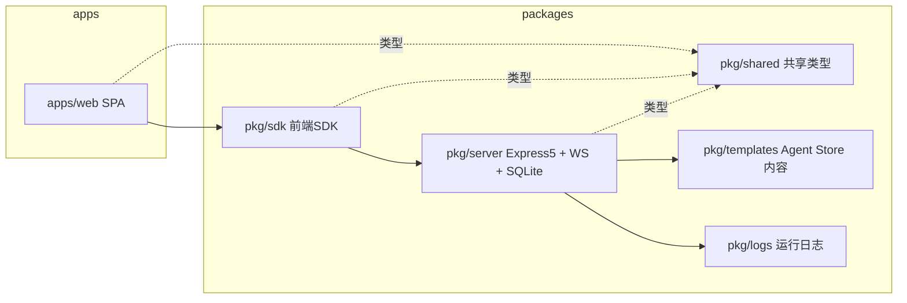

# flow_spaces 架构总览

## 项目定位

Flow Spaces — 工作流可视化编辑器与 Mini App 平台（monorepo `flow-spaces` v0.1.0）。自 flow-spaces（Next.js 全栈）迁移为 **Vite + React 19 SPA + Express 5 后端** 分离架构（迁移对照全记录见 `MIGRATION-NOTES.md`）。

产品能力：多 AI Agent 运行时接入（Claude Code/Codex/Grok/Gemini CLI/LangChain 等 20 个 runtime id）、可视化工作流引擎、Mini App（用户 JSX 沙箱应用）、聊天/终端/语音实时通道、知识库与向量检索、Git 集成、Agent Store（插件/模板分发）、Notification Hub。

## 运行形态

- 开发：`pnpm dev`（web 5173）+ `pnpm dev:server`（server 3110）；web 经 vite 代理 `/api` `/ws` `/public` `/static` 到 server。
- 构建链：`shared → sdk`（tsc）→ web（vite）/ server（tsc）。
- 部署：server 静态托管 web 构建产物 + `/agents-store` 分发模板包。

## 模块关系

## 重要设计取舍

- **Next.js → SPA**：业务代码零改动，靠 vite alias 把 `next/*`、`next-intl` 重写到 `apps/web/src/shims/`。
- **类型单源**：所有 REST/WS 契约在 shared；SDK 24 模块封装全部 HTTP；组件不直接 fetch。
- **运行时数据入库**：`packages/server/flow-spaces-data/`（mini-apps/plugins/工作流/模板）随 git 跟踪，但执行历史、版本快照、mini-app 用户数据通过 .gitignore 排除。
- **BoardUI 源码级组件库**：UI 组件随仓库持有（apps/web/components/base|application），MCP 安装更新。
