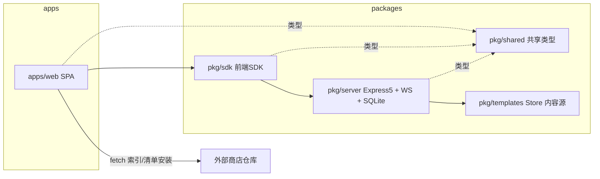

# flow_spaces 架构总览

## 项目定位

Flow Spaces — 工作流可视化编辑器与 Mini App 平台（monorepo `flow-spaces` v0.1.0）。自 flow-spaces（Next.js 全栈）迁移为 **Vite + React 19 SPA + Express 5 后端** 分离架构（迁移笔记已不随本仓分发，见 git 历史）。

产品能力：多 AI Agent 运行时接入（Claude Code/Codex/Grok/Gemini CLI/LangChain 等 20 个 runtime id）、可视化工作流引擎、Mini App（用户 JSX 沙箱应用 + 商店分发）、聊天/终端/语音实时通道、知识库与向量检索、Git 集成、Agent Store（agents/mcps/skills 内容分发）、Notification Hub。

## 运行形态

- 开发：`pnpm dev`（web 5173）+ `pnpm dev:server`（server 3110，`.env` 设 `PORT=3110`、`FLOW_SPACES_DATA_DIR=./flow-spaces-data`）；web 经 vite 代理 `/api` `/ws` `/public` `/static` 到 server。
- 构建链：`shared → sdk`（tsc）→ web（vite）/ server（tsc）。
- 部署：server 静态托管 web 构建产物 + `/agents-store` 分发 templates 包内容。

## 模块关系

**外部商店仓库**（2026-11 拆仓，商店内容源不再随本仓分发）：

| 前缀（索引 path） | 仓库 | 说明 |
|---|---|---|
| `plugins/` | hunmer/flow-spaces-plugins | 插件模板 |
| `workflows/` | hunmer/flow-spaces-workflows | 工作流模板 |
| `mini-app/` | hunmer/flow-spaces-mini-apps | Mini App 商店源（app.json 清单） |
| — | hunmer/game-asset-canvas | 独立 mini-app 产品示例（GitHub URL 安装） |

路由实现在 `apps/web/src/lib/agent-store.ts`（`REPO_ROUTES` + `resolveStoreUrl`）：无自定义 base 时按前缀剥掉分类前缀拼到对应仓库 raw 根（gh-proxy），其余内容回落 `hunmer/flow_spaces` master 的 `packages/templates/`。

## 重要设计取舍

- **Next.js → SPA**：业务代码零改动，靠 vite alias 把 `next/*`、`next-intl` 重写到 `apps/web/src/shims/`。
- **类型单源**：所有 REST/WS 契约在 shared；SDK 24 模块封装全部 HTTP；组件不直接 fetch。
- **商店拆仓**：plugins/workflows/mini-apps 从 `packages/templates` 迁出至独立 GitHub 仓库，索引与内容均从远端拉取（gh-proxy 默认代理，localStorage `flow-spaces:store-api-base` 可指向自定义镜像；旧同源 `/agents-store` base 被自动清除回落）。本仓只保留 agents/mcps/skills/output-styles/prompt/skillspackage。mini-app 安装改为**清单增量安装**：仓库根 `app.json` 携带元数据 + 文件级 md5 清单，server 按清单比对跳过已一致文件，无需 zip。
- **运行时数据目录**：`getDataDir()`（`FLOW_SPACES_DATA_DIR` / `AGENT_SPACES_DATA_DIR` → 默认 `~/.flow-spaces-data/`；本仓库 `.env` 指向 `packages/server/flow-spaces-data/`）。其中 plugins/、workflows/、mini-apps/ 整目录不入库（`.gitignore` 注明拆仓去向）；入库的只有种子数据（agent-templates 3 组、llm catalog、workspace 注册表、uploads、sqlite 库，共 25 文件）。
- **BoardUI 源码级组件库**：UI 组件随仓库持有（apps/web/components/base|application），MCP 安装更新。
